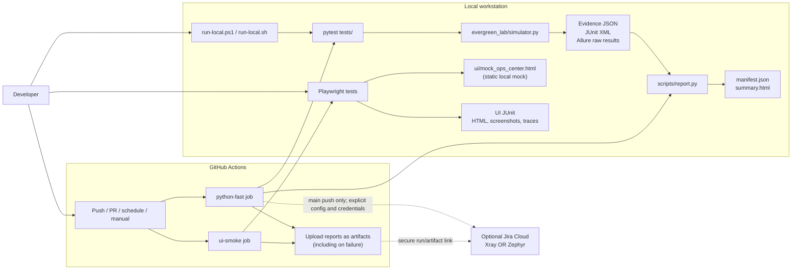
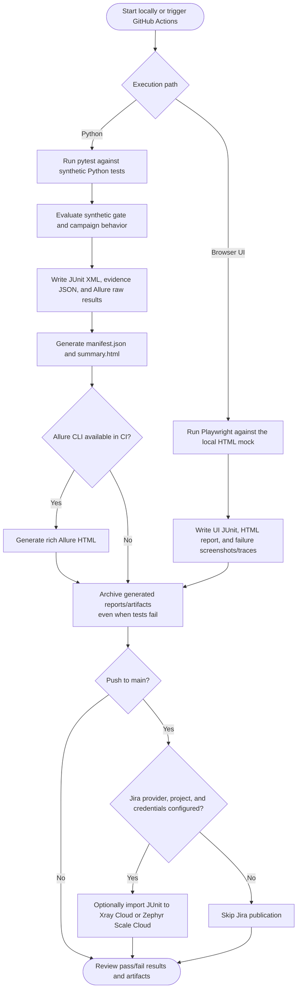

# Architecture and execution flow

> **Synthetic training project only.** These diagrams describe this repository, not the UCSF Evergreen product or its infrastructure.

## Architecture

The Python simulator exercises synthetic witness validation, gate decisions, campaign state, authorization examples, and record sealing. The browser suite opens only the static local mock. Neither test path connects to UCSF or validates a real product.

## QA execution flow

The Python and UI suites are separate CI jobs; the diagram joins them at artifact review to show the overall workflow. Jira import is optional and is only attempted by the workflow on a push to `main`. JUnit carries execution status; detailed evidence remains in the archived reports and artifacts.
